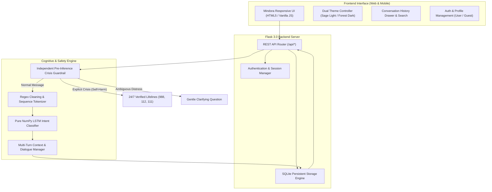

# Mindora: AI Mental Wellness Companion

**Tagline:** *Your space to feel heard.*  
**Category:** AI Mental Wellness Companion

[](https://www.python.org/)
[-emerald.svg)](https://numpy.org/)
[](https://flask.palletsprojects.com/)
[](https://sqlite.org/)
[](#3-dual-theme-system)
[](#6-crisis-safety-architecture)

> **⚠️ Healthcare Disclaimer**  
> Mindora is an AI companion and does not replace professional mental healthcare. It is not a licensed therapist, psychologist, medical practitioner, or emergency psychiatric service. If you are experiencing thoughts of self-harm or immediate crisis, please reach out directly to 24/7 emergency hotlines (such as **988** in the US/Canada, **111/999** in the UK, **112/14416** in India, or visit [findahelpline.com](https://findahelpline.com)).

---

## 1. Executive Summary & Product Vision

**Mindora** is a calm, welcoming, trustworthy digital space designed to help people express their thoughts, process emotions, and feel heard without fear of judgment.

Unlike generic chatbot wrappers or academic toy demos, Mindora is engineered as a **production-style full-stack consumer application**:
- **Core Neural Engine:** A word-level **Long Short-Term Memory (LSTM)** neural network written completely from scratch in pure **NumPy**—without PyTorch, TensorFlow, Keras, or Scikit-learn.
- **Persistent Database:** SQLite engine (`database.py`) providing user accounts, secure password hashing, isolated conversation threads, and full chat history persistence.
- **Multi-Turn Conversational Intelligence:** Deep context resolution across 5–8+ exchanges with empathetic validation, single open-ended follow-up questions, and zero toxic positivity.
- **Dual-Theme Nature-Inspired UI:** Dedicated **Soft Sage & Ivory** (Light Mode) and **Muted Forest Night** (Dark Mode) with zero theme-flicker and automatic system preference detection.
- **Independent Safety Layer:** Strict three-tier crisis detection that separates explicit self-harm from ambiguous distress and ordinary emotional sadness.

---

## 2. Full Architecture Diagram



---

## 3. Dual Theme System

Mindora provides a dual-theme experience designed for calm readability both day and night:

### A. Light Mode (Default Theme: Soft Sage & Ivory)
- **Background:** `#F5F7F1`
- **Surface:** `#FFFFFF`
- **Primary Sage:** `#829B83`
- **Deep Sage:** `#526F5A`
- **Soft Eucalyptus:** `#B7C9B5`
- **Accent Teal:** `#789A91`
- **Primary Text:** `#293A30`
- **Secondary Text:** `#778278`
- **Borders:** `#E5EAE1`

### B. Dark Mode (Night Theme: Muted Forest Night)
- **Background:** `#151C19`
- **Main Surface:** `#1E2923`
- **Secondary Surface:** `#26352D`
- **Primary Sage:** `#9AB69B`
- **Deep Accent:** `#789B83`
- **Soft Highlight:** `#B6CBB4`
- **Text:** `#E8EEE8`
- **Secondary Text:** `#A3B2A6`
- **Borders:** `#34443A`

### C. Theme Selection
- **Light (`sun`), Dark (`moon`), and System/Auto (`monitor`)**.
- Uses an inline `<head>` script to apply preferences before DOM rendering, **eliminating theme flicker**.
- Automatically listens to OS dark mode changes when set to System mode.

---

## 4. Multi-Turn Conversational Intelligence

Mindora moves far beyond simple one-shot intent matching by maintaining conversational state, emotional trajectories, and entity tracking across multiple turns:

### Canonical Progression Example
```text
User: I'm not feeling good.
Mindora: I'm sorry you're having a difficult day. Has something happened recently, or have you been feeling this way for a while?

User: I don't know. I just feel empty.
Mindora: Sometimes it's difficult to put a feeling into words. That's okay. Does it feel more like loneliness, sadness, or being disconnected from everything?

User: Maybe loneliness.
Mindora: Do you feel lonely even when you're around people, or is it more that you don't have someone you can comfortably open up to?
```

### Conversational Design Principles
1. **Validation Before Inquiry:** Always acknowledges the user's emotion before asking a question.
2. **Single Follow-Up Questions:** Asks exactly one relevant open-ended question at a time to prevent interrogation fatigue.
3. **Question Registry:** Tracks asked questions within each session to avoid repetitive loops.
4. **No Unsolicited Advice:** Avoids giving premature advice or cliché motivational quotes.
5. **Accepts Uncertainty:** Validates phrases like *"I don't know"* or *"not sure"* without pressuring the user to explain things they cannot yet articulate.

---

## 5. NumPy LSTM Mathematical Working

The core intent classification model is written entirely in **NumPy** from scratch without high-level ML frameworks.

### 5.1 Forward Pass (at timestep $t$):
1. **Embedding Lookup:**
   $$\mathbf{x}_t = \mathbf{W}_{\text{emb}}[w_t] \in \mathbb{R}^D$$
2. **Combined Gate Affine:**
   $$\mathbf{Z}_t = \mathbf{x}_t \mathbf{W}_{xh} + \mathbf{h}_{t-1} \mathbf{W}_{hh} + \mathbf{b}_h \in \mathbb{R}^{4H}$$
3. **Gates:**
   - **Forget Gate:** $\mathbf{f}_t = \sigma(\mathbf{Z}_t[0:H]) = \frac{1}{1 + e^{-\mathbf{Z}_t[0:H]}}$
   - **Input Gate:** $\mathbf{i}_t = \sigma(\mathbf{Z}_t[H:2H])$
   - **Candidate Cell:** $\tilde{\mathbf{c}}_t = \tanh(\mathbf{Z}_t[2H:3H])$
   - **Output Gate:** $\mathbf{o}_t = \sigma(\mathbf{Z}_t[3H:4H])$
4. **State Updates:**
   $$\mathbf{c}_t = \mathbf{f}_t \odot \mathbf{c}_{t-1} + \mathbf{i}_t \odot \tilde{\mathbf{c}}_t$$
   $$\mathbf{h}_t = \mathbf{o}_t \odot \tanh(\mathbf{c}_t)$$
5. **Dense Output & Softmax:**
   $$\text{logits} = \mathbf{h}_{\text{final}} \mathbf{W}_{hy} + \mathbf{b}_y \in \mathbb{R}^C$$
   $$\hat{y}_k = \frac{e^{\text{logits}_k - \max(\text{logits})}}{\sum_j e^{\text{logits}_j - \max(\text{logits})}}$$

### 5.2 Backpropagation Through Time (BPTT):
- Exact analytical gate derivatives $\mathbf{da}_f, \mathbf{da}_i, \mathbf{da}_c, \mathbf{da}_o$ propagate backward through all timesteps.
- Parameter gradients $\mathbf{dW}_{xh}, \mathbf{dW}_{hh}, \mathbf{db}_h, \mathbf{dW}_{\text{emb}}$ are accumulated, clipped at global norm $\le 5.0$, and updated using the **Adam** optimizer.

---

## 6. Crisis Safety Architecture

The safety layer is decoupled from LSTM model predictions:

| Tier | Trigger | System Action | Crisis Screen? |
|---|---|---|:---:|
| **Tier 1: Explicit Crisis** | Unambiguous self-harm or suicide intent (`"want to die"`, `"kill myself"`, `"commit suicide"`, `"plan to die"`). | Provides verified 24/7 lifelines (988 US/CA, 111/999 UK, 112/14416 India, findahelpline.com). | ✅ **Yes** |
| **Tier 2: Ambiguous Distress** | Fatigue or burnout phrases (`"tired of everything"`, `"can't take this anymore"`). | Asks a gentle clarifying question to separate daily burnout from self-harm. | ❌ No |
| **Tier 3: Ordinary Distress** | Common emotional sadness (`"I feel sad"`, `"I don't know"`, `"I'm empty"`, `"I'm lonely"`). | Natural, supportive multi-turn dialogue. | ❌ No |

*Note: Raw neural network predictions alone can never trigger the emergency crisis screen.*

---

## 7. Database & Persistent Storage

SQLite database (`mindora.db`) with relational tables and cascading deletes:
- **`users`**: `id`, `username`, `email`, `password_hash` (PBKDF2-HMAC-SHA256 via Werkzeug), `theme_pref`, `created_at`.
- **`conversations`**: `id` (UUID), `user_id` (FK), `guest_id`, `title`, `created_at`, `updated_at`.
- **`messages`**: `id` (UUID), `conversation_id` (FK), `role` (`user`/`assistant`), `content`, `intent`, `confidence`, `is_crisis`, `created_at`.

Guest conversations are automatically linked to a user account when they register or log in.

---

## 8. Project Structure

```
Mindora/
├── app.py                     # Production Flask application & RESTful routing
├── config.py                  # Environment-based configuration
├── database.py                # SQLite database engine, auth, and CRUD operations
├── train.py                   # Pure NumPy LSTM training pipeline & loss visualization
├── preprocess.py              # Text cleaning, regex tokenizer, vocabulary & sequence encoder
├── model.py                   # Pure NumPy LSTM network, analytical BPTT & Adam optimizer
├── chatbot.py                 # Chatbot orchestrator, safety layer, and session binder
├── conversation.py            # ConversationState (in-memory + database reconstruction)
├── dialogue_manager.py        # Context resolution, empathetic response synthesizer & auto-titler
├── requirements.txt           # Production dependencies
├── README.md                  # Comprehensive documentation and guides
├── .env.example               # Environment variables template
├── .gitignore                 # Version control ignore rules
│
├── data/
│   ├── intents.json           # Raw mental health intent dataset
│   ├── vocabulary.json        # Saved vocabulary with <PAD> and <UNK> mappings
│   ├── tags.json              # Saved intent classes & clinical response pools
│   └── mindora.db             # Persistent SQLite database
│
├── models/
│   └── lstm_weights.npz       # Saved NumPy compressed model parameters
│
├── templates/
│   └── index.html             # Serene dual-theme web application interface
│
├── static/
│   ├── style.css              # Nature-inspired design system (Soft Sage & Forest Night)
│   └── script.js              # Theme switcher, auth, conversation history drawer & chat engine
│
├── outputs/
│   └── training_loss.png      # Matplotlib loss & accuracy training curves
│
├── test_app.py                # Integration tests (Auth, conversations, DB, chat APIs)
├── test_chatbot.py            # Chatbot unit tests (Thresholds, empty inputs, safety)
└── test_multiturn.py          # Multi-turn canonical dialogue progression tests
```

---

## 9. API Specification

| Method | Endpoint | Description |
|---|---|---|
| `GET` | `/api/health` | Returns server readiness, model status, and database connection. |
| `POST` | `/api/auth/register` | Creates a new account with hashed password and migrates guest chats. |
| `POST` | `/api/auth/login` | Authenticates user credentials and establishes session. |
| `POST` | `/api/auth/logout` | Clears active user session. |
| `GET` | `/api/auth/me` | Returns current user profile or guest status and theme preference. |
| `PATCH` | `/api/auth/settings` | Updates user preferences (`theme_pref`: `light`/`dark`/`system`). |
| `DELETE` | `/api/auth/account` | Permanently deletes account and cascades deletion of all conversations. |
| `GET` | `/api/conversations` | Lists conversations for the current actor, supporting `?search=...`. |
| `POST` | `/api/conversations` | Creates a fresh conversation thread. |
| `GET` | `/api/conversations/<id>` | Retrieves conversation metadata and full message history. |
| `PATCH` | `/api/conversations/<id>` | Renames a conversation title. |
| `DELETE` | `/api/conversations/<id>` | Deletes an individual conversation and all its messages. |
| `POST` | `/api/conversations/clear`| Clears all conversations for the current actor. |
| `POST` | `/api/chat` | Main dialogue endpoint: runs safety, LSTM, and multi-turn engine; persists messages. |

---

## 10. Installation & Running

### 1. Prerequisites
- Python 3.10+
- `pip` package manager

### 2. Install Dependencies
```bash
python -m pip install -r requirements.txt
```

### 3. Run Automated Tests
```bash
python -m unittest discover -s . -p "test_*.py"
```

### 4. Start the Application
```bash
python app.py
```
Open your browser and navigate to:
```
http://127.0.0.1:5000/
```

---

## 11. Production Deployment Guide

For production environments:
1. **Set Environment Variables:**
   ```bash
   export MINDORA_SECRET_KEY="generate-a-strong-secret-key"
   export FLASK_DEBUG=0
   export PORT=5000
   ```
2. **Run with Production WSGI Server (Gunicorn or Waitress):**
   ```bash
   # On Linux/macOS
   gunicorn --workers 4 --bind 0.0.0.0:5000 app:app

   # On Windows
   waitress-serve --listen=0.0.0.0:5000 app:app
   ```
3. **Database Volume:** Ensure the `data/` directory is mounted on a persistent volume.
